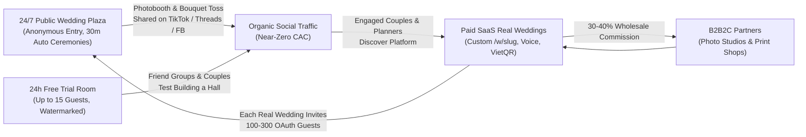
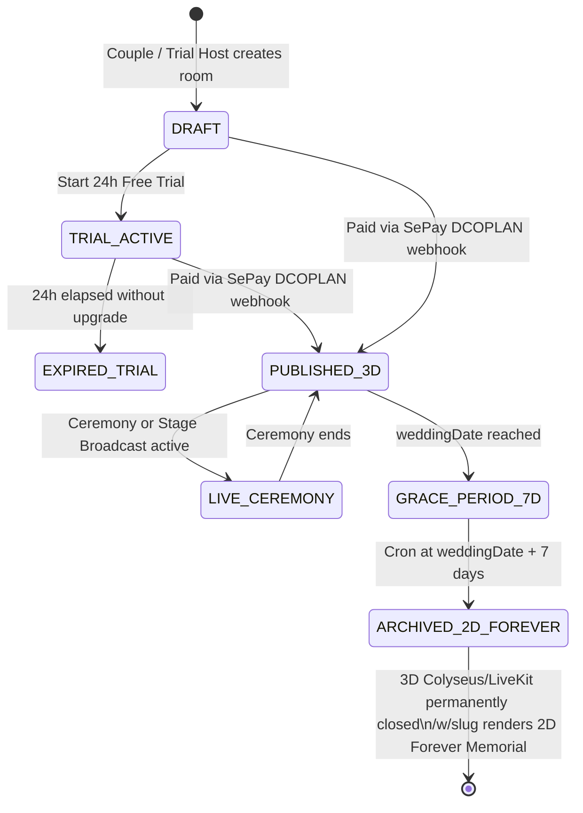

# 00 — Overview & Business Model

## 1. Product Positioning & Core Insight

Traditional wedding software (static e-invitations, RSVP forms) suffers from **one-time utility and low engagement**: guests glance at the date and address, then close the tab in 15 seconds. Conversely, viral browser-based 3D social experiences like *Sansa Temple* proved that Vietnamese internet users—especially Gen Z and Millennials—love **zero-friction, browser-native 3D Chibi spaces** where they can customize a tiny avatar, wander around with friends, take screenshots, and share them organically on TikTok, Facebook, and Threads.

**DamCuoiOnline** bridges these two worlds into a **3D Multiplayer Virtual Wedding Platform** built around three pillars:
1. **Instant Browser Accessibility**: No app download required. Runs smoothly on mid-range smartphones inside mobile browsers (`Safari`, `Chrome`) and gracefully inside `Zalo` / `Messenger` WebViews.
2. **Authentic Vietnamese Wedding Atmosphere**: Localized 3D themes (Luxury Hotel Ballroom, Outdoor Sunset Garden, and *Rạp Cưới Miền Tây* coconut-leaf archway), round 10-seat banquet tables for nostalgic group conversations (`1-2-3 Dzô`), photo galleries, and culturally respectful gifting.
3. **Zero-Custody Trust & Automation**: Real wedding gifts go bank-to-bank via standard VietQR and trigger 3D fireworks **only** when verified by SePay banking webhooks—preventing fake-transfer pranks and eliminating financial custody liability.

---

## 2. The Hybrid `1+2` Product-Led Growth (PLG) Flywheel

The wedding industry normally suffers from prohibitive Customer Acquisition Cost (CAC) because couples only marry once. Combining **Model 2 (Free Viral Community Space)** with **Model 1 (Paid Private Wedding SaaS)** creates a self-sustaining organic flywheel:

### Strict Safety & Trust Firewall (Free vs. Paid)
Following lessons learned from online temple apps flagged by Vietnamese authorities over misleading donation prompts, DamCuoiOnline enforces a **hard technical firewall** between free viral rooms and real-money wedding rooms:

| Safeguard | 24/7 Public Plaza | 24h Free Trial Room | Paid SaaS Real Wedding |
| :--- | :--- | :--- | :--- |
| **VietQR Gift Box (`GiftIntent`)** | **Hard-disabled** (API & UI locked) | **Hard-disabled** (API & UI locked) | **Enabled** (100% SePay webhook-verified) |
| **Identity Requirement** | Anonymous `GuestSession` | Host OAuth + Guest OAuth | **Mandatory Social OAuth (`Zalo`, `Google`, `FB`)** |
| **Photobooth Output** | Branded Public Plaza frame | **Mandatory brand watermark** | Clean couple-branded Polaroid frame |
| **Moderation** | Profanity filter + Auto-kick | Host Mute/Kick | Host + Delegated MC permanent Social-UID Ban |

---

## 3. Feature & Pricing Comparison Matrix

| Feature / Quota | 24/7 Public Plaza (Free) | 24h Trial Room (Free) | Happiness Tier (`Gói Hạnh Phúc`) | Fulfillment VIP (`Gói Viên Mãn`) |
| :--- | :--- | :--- | :--- | :--- |
| **Target Audience** | Casual visitors, social roleplay | Couples testing the 3D builder | Small/medium weddings | Full-scale & diaspora weddings |
| **Suggested Price (VND)** | `0 VND` | `0 VND` | `399,000 VND / event` | `1,199,000 VND / event` |
| **Max Concurrent Guests** | `50-60` per sharded hall | `15` CCU hard cap | `100` CCU (auto-sharded at 55) | `Unlimited` (auto-sharded halls) |
| **Custom Room URL & PIN** | Fixed `/plaza` | Temporary 24h `/w/<trial>` | Custom `/w/<slug>` + 4-digit PIN | Custom `/w/<slug>` + 4-digit PIN |
| **Grid-Snap 3D Builder** | Read-only system layout | Full builder (cannot publish VietQR) | Full builder (3 themes, custom prefabs) | Full builder + VIP themes & priority assets |
| **3D Photo Gallery Slots** | System demo photos | Up to `6` photos | Up to `20` photos | Up to `50` photos |
| **Table-Zone Voice Chat** | **Disabled** (text bubbles only) | **Disabled** (text bubbles only) | **Disabled** (text + emotes + bubbles) | **Enabled** (`LiveKit` per-table + `-12dB` stage ducking) |
| **Stage LED Video / Live** | System loop video | Preview only | External YouTube/Vimeo/Drive PiP | External PiP + Room-Synced Ceremony Play |
| **Bride/Groom Dual-Mode** | System Auto-NPCs only | Auto-NPC + Host Takeover | Auto-NPC + Bride/Groom Takeover | Auto-NPC + Takeover + Delegated `MC` Roles |
| **VietQR Webhook Gift Box** | **Disabled** | **Disabled** | **Enabled** (SePay verified) | **Enabled** + Private Ledger CSV/PDF Export |
| **Active 3D Lifespan** | Permanent 24/7 | Auto-expires after `24 hours` | Active through `weddingDate + 7 days` | Active through `weddingDate + 7 days` |
| **Post-Wedding Archive** | N/A | Auto-deleted after 7 days | **Permanent 2D Memorial Page** | **Permanent 2D Memorial Page + Exports** |

### B2B2C Partner Wholesale Channel
- **Wedding Photography Studios & Invitation Print Shops** receive a partner portal to bulk-purchase Happiness/VIP vouchers at a **30–40% wholesale discount**.
- Print shops include a dedicated QR block on physical paper invitations (*"Ở xa không về kịp? Quét mã dự tiệc 3D cùng cô dâu chú rể"*) driving high-intent guests directly into the couple's `/w/<slug>` hall.

---

## 4. Room Lifecycle State Machine

Every `Wedding` record follows a strict lifecycle state machine designed to balance magical real-time 3D presence around the wedding day with near-zero long-term server compute costs:

### Lifecycle Rules
1. **`TRIAL_ACTIVE` (`24 hours`)**: Allows the couple to experience the Grid-Snap Builder and invite up to 15 friends to test movement and Photobooth. At `expiresAt`, the room disconnects active sockets and prompts the host to upgrade; R2 assets are purged 7 days later if unpaid.
2. **`PUBLISHED_3D` -> `GRACE_PERIOD_7D`**: Paid rooms can be opened days or weeks ahead of `weddingDate` for guests to browse pre-wedding photos and leave Guestbook wishes, remaining fully interactive in 3D until **`weddingDate + 7 days`**.
3. **`ARCHIVED_2D_FOREVER` (`> weddingDate + 7 days`)**: An automated daily cron closes the 3D Colyseus room, stops issuing LiveKit tokens, disables the VietQR Gift Box, and switches `/w/<slug>` permanently to a **lightweight static/ISR 2D Memorial Page** (Album + Photobooth Wall + Guestbook + Embedded Video) hosted for pennies.

---

## 5. Non-Custodial Legal & Payment Compliance

Under Vietnamese financial regulations (Decree 52/2024/ND-CP on cashless payments), platforms that hold user funds in escrow or collect money on behalf of merchants require an Intermediary Payment Service License from the State Bank of Vietnam (SBV).

**DamCuoiOnline cleanly avoids payment custody risk by design:**
- **Direct Bank-to-Bank Transfers**: Every VietQR code in a wedding hall encodes the **Bride or Groom's own commercial bank BIN and account number** directly via the official Napas EMVCo standard. Money **never touches** a DamCuoiOnline bank account.
- **Read-Only Transaction Verification**: Couples connect their own read-only webhook token from licensed transaction-notification providers (`SePay`). DamCuoiOnline solely listens for incoming transfer descriptions matching `DCO<shortId>` to trigger the 3D celebration toast and record the private `GiftLedger`.
- **Zero Commission on Wedding Gifts**: The platform charges `0%` fee on guests' wedding gifts. Platform revenue comes strictly from **SaaS software package fees** (`DCOPLAN<orderCode>`) paid directly to the company's own business bank account.
