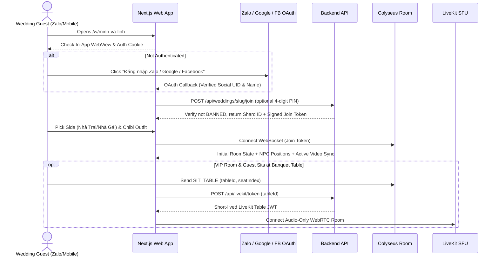

# 01 — User Flows & Feature Specifications

## 1. End-to-End User Journeys

### 1.1 Journey A: 24/7 Public Wedding Plaza (5-Second Viral Entry)
Designed for maximum viral sharing on TikTok, Threads, and Facebook—zero registration friction.
1. Visitor opens `/` or `/plaza` on mobile or desktop browser.
2. Client silently mints or restores an anonymous `GuestSession` UUID stored in `localStorage`.
3. Visitor sees a single lightweight modal:
   - Enter display nickname (profanity-filtered; defaults to poetic Vietnamese names like *"Khách Mùa Thu"* or *"Bạn Hiền"* if left blank).
   - Pick Chibi outfit (*Áo dài truyền thống*, *Vest lịch lãm*, *Đầm dạ hội*) + hair/accent color.
   - Tap **"Vào Quảng Trường Ngay"** (`Enter Plaza Now`).
4. Client auto-joins the least-loaded active plaza shard (`<= 55` players) and spawns at the Reception Gate (`SpawnGate`).
5. **Automated Plaza Loop**: Every `25 minutes`, server Auto-NPCs trigger a celebratory Stage Ceremony (countdown -> sparklers -> bouquet toss mini-game) so solo visitors always witness lively action and can snap Photobooth photos immediately.

---

### 1.2 Journey B: Couple Onboarding, SaaS Checkout & Setup Wizard
1. Couple visits `/create` and authenticates via **Mandatory Social OAuth (`Zalo`, `Google`, or `Facebook`)**.
2. Chooses either **"Tạo Phòng Thử 24h (Miễn Phí)"** (`24h Trial`) or selects **Happiness / Fulfillment VIP** tier.
3. **Instant SaaS Checkout (for Paid Tiers)**:
   - Backend creates `SaasOrder` with unique code `DCOPLAN<6-char>` and renders a Napas VietQR targeting the **Platform Bank Account**.
   - Couple scans via any banking app; SePay webhook confirms payment within `2-5 seconds`, transitions `Wedding.status` to `PUBLISHED_3D`, and notifies the browser over SSE/WebSocket.
4. **Setup Wizard**:
   - Configure slug (`/w/minh-va-linh`), `weddingDate`, optional 4-digit PIN, and external `videoEmbedUrl` (`YouTube Live` / `Vimeo` / `Google Drive`).
   - Enter personal Bank BIN + Account Number + SePay API secret (optional test ping button verifies webhook connectivity).
   - Open the **Grid-Snap 3D Scene Builder**: select a starter template (*Luxury Ballroom*, *Sunset Garden*, or *Rạp Cưới Miền Tây*), arrange banquet tables (naming each table e.g. *"Bàn Đại Học Bách Khoa"*, *"Họ Nhà Gái"*), place photo frames and upload pre-wedding images to Cloudflare R2, and configure Auto-NPC ceremony schedule.
   - Invite Co-Host (`BRIDE`/`GROOM`) and delegated Emcees (`MC` role) via secure role-invite links.

---

### 1.3 Journey C: Real Wedding Guest Onboarding (Mandatory Social OAuth)
To guarantee troll-free real weddings while preserving mobile convenience:

> **In-App Browser Note**: Guests tapping an invitation inside Zalo/Messenger complete OAuth and enter the 3D hall directly inside the WebView. If they tap **"Bật Mic Bàn Tiệc"** (`Enable Table Mic`) inside a WebView that blocks `getUserMedia`, the UI presents a 1-tap **"Mở bằng Safari / Chrome để nói chuyện"** button preserving their auth session via short-lived handoff token.

---

## 2. Dual-Mode Bride, Groom & MC System

Real-life couples cannot hold their phones during their actual wedding banquet. The platform solves this with **Dual-Mode Avatar Control**:

| Mode | Triggered By | Behavior in 3D Hall |
| :--- | :--- | :--- |
| **Auto-NPC Mode (Default)** | Server State Machine (`NpcSchema`) | Bride and Groom NPCs stand near the Reception Gate (`Greeting` loop with wave animations) before ceremony time, then automatically walk to the Stage at scheduled ceremony timestamps, perform toast/cake animations, and pose for guest Photobooth snapshots. |
| **Live Takeover (`NPC_TAKEOVER`)** | Authenticated `OWNER`, `BRIDE`, `GROOM`, or `MC` | Host clicks **"Nhập vai Trực tiếp"** in the Host HUD. Server hides/suspends the corresponding Auto-NPC and transfers that character rig (white wedding gown / groom suit) directly to the authenticated user's WebSocket player control. Releasing (`NPC_RELEASE`) smoothly returns the avatar to Auto-NPC routines. |
| **MC Stage Broadcast (`STAGE_BROADCAST`)** | `OWNER`, `BRIDE`, `GROOM`, or `MC` | Host activates megaphone icon on Stage. LiveKit publishes host audio to `wedding_<id>_stage`, sets `stageBroadcastActive = true` in Colyseus state, and triggers **`-12dB` automatic audio ducking** across all banquet table voice channels so the entire hall hears the toast clearly. |

---

## 3. Core Interactive Features & Viral Mechanics

### 3.1 Spatial Table Voice Chat & `"1... 2... 3... DZÔ!!"`
- **Silent Promenade, Lively Tables**: Walking through the gallery or near the stage plays only gentle ambient wedding music (`BGM`), avoiding the cacophony of 50 simultaneous voices.
- **Lazy Table Connection**: Clicking an empty chair on a `BanquetTablePrefab` seats the Chibi avatar and connects LiveKit strictly to `wedding_<id>_table_<tableId>` (`8-10` seats max). An animated green sound-wave ring floats above speaking avatars.
- **Synchronized Table Toast**: Any seated guest (or the MC) can tap **"1-2-3 Dzô!"**, triggering a 3-second countdown overlay for everyone at that table, followed by synchronized `cheers` animations, glass-clinking SFX, and micro confetti.

### 3.2 Synchronized Stage Ceremonies
Triggered either by the couple's automated schedule or manually by an authorized `MC` / Host during Live Takeover:
- **Cake Cutting & Champagne Tower**: Center stage cake/tower prefabs animate with particle sparkles; all players receive an optional **"Hướng về sân khấu"** (`Look at Stage`) camera focus prompt.
- **Pathway Sparklers (`Pháo Điện Lối Đi`)**: Synchronized vertical golden particle emitters along the central aisle.

### 3.3 Physics-Based Bouquet Toss Mini-Game (`Tung Hoa Cưới`)
Designed as the centerpiece viral moment for social sharing:
1. `MC` or Auto-NPC triggers `TOSS_BOUQUET` on Stage; a 5-second countdown alerts the hall to gather in front of the stage.
2. Server generates deterministic parabolic trajectory parameters (`origin`, `targetLandingPos`, `flightDurationMs = 2400`, `tossStartTimestamp`) and broadcasts `BouquetSchema`.
3. Every client renders the spinning bouquet arc identically. Players move into the landing zone and tap **"Bắt Hoa!"** (`ATTEMPT_CATCH` triggers `jump_catch` animation).
4. Server validates the **first** non-banned player within `catchRadius = 1.8m` when `elapsed >= flightDurationMs * 0.85` (anti-cheat server authority).
5. **Reward**: Winner receives a golden flower crown & floating title **`"Người tiếp theo lên xe hoa"`** for the remainder of the session, recorded in `BouquetCatch`, and immediately offered a 1-click Photobooth snapshot card ready for Instagram/TikTok/Facebook Stories.

### 3.4 3D Polaroid Photobooth & Social Sharing
- Clicking the camera icon switches temporarily to a **Framing Camera** (allows dragging angle around the player's Chibi avatar, companions at the table, or beside the Bride/Groom NPCs on stage).
- Client captures the WebGL canvas (`preserveDrawingBuffer: false` handled cleanly via synchronous `render()` + `canvas.toBlob` on capture frame) and composites a high-resolution **Polaroid PNG (`1080x1350`)** via an offscreen 2D canvas featuring:
  - Couple's names & `weddingDate`
  - Decorative Vietnamese floral border
  - **Trial Rule**: Free 24h Trial rooms burn a visible *"DamCuoiOnline.vn — Bản Dùng Thử"* footer watermark; Paid rooms omit the trial watermark and display a subtle couple monogram.
- Uploaded to Cloudflare R2 (`photobooth/<weddingId>/<photoId>.png`), saved to `PhotoAsset` (capped at `3` saved shots per guest to prevent R2 spam), and exposed via native Web Share API / direct image download.

### 3.5 Webhook-Verified VietQR Gift Box (`Hộp Mừng Cưới`)
1. Guest approaches the `GiftBoxPrefab` at the Reception Gate (or taps the Gift icon in HUD).
2. Guest enters a heartfelt blessing (`wishMessage`) and taps **"Tạo Mã Mừng Cưới VietQR"**.
3. Backend creates a `GiftIntent` with a short unique code (e.g., `DCO8F3A2`) and generates a dynamic Napas EMVCo VietQR image encoding the **Bride/Groom's personal bank account** and pre-filled transfer note `DCO8F3A2`.
4. Guest scans and transfers via their banking app.
5. **No optimistic UI faking**: The hall waits until `SePay` sends a verified webhook confirming the actual bank credit.
6. Upon webhook verification:
   - Server records exact `amountVnd` in private `GiftLedger`.
   - Server broadcasts `GIFT_CELEBRATION_EVENT` containing **ONLY `guestName` and `wishMessage`** (strictly excluding `amountVnd` to respect Vietnamese etiquette).
   - Every hall shard bursts heart fireworks and shows an elegant banner: *"Bạn [Nguyễn Minh] vừa gửi lời chúc phúc tới Cô dâu & Chú rể: [Chúc hai bạn trăm năm hạnh phúc!]"*.

### 3.6 Permanent 2D Forever Memorial Archive (`> weddingDate + 7 days`)
Once the 7-day post-wedding grace period expires, `/w/<slug>` automatically serves a static/ISR **2D Memorial Page** containing:
- Hero Cover (Couple names, date, and final wedding video embed).
- **Pre-Wedding Photo Album** (high-resolution lightbox).
- **Virtual Photobooth Wall** (grid of Polaroid memories taken by 3D guests).
- **Sổ Lưu Bút (Guestbook Wall)** & **Bouquet Winner Hall of Fame**.
- **Host-Only Private Dashboard Tab**: Remains accessible to `OWNER`/`BRIDE`/`GROOM` for exporting the complete `GuestbookEntry` list and `GiftLedger` (including VND amounts and bank ref IDs) to **CSV or formatted PDF**.
