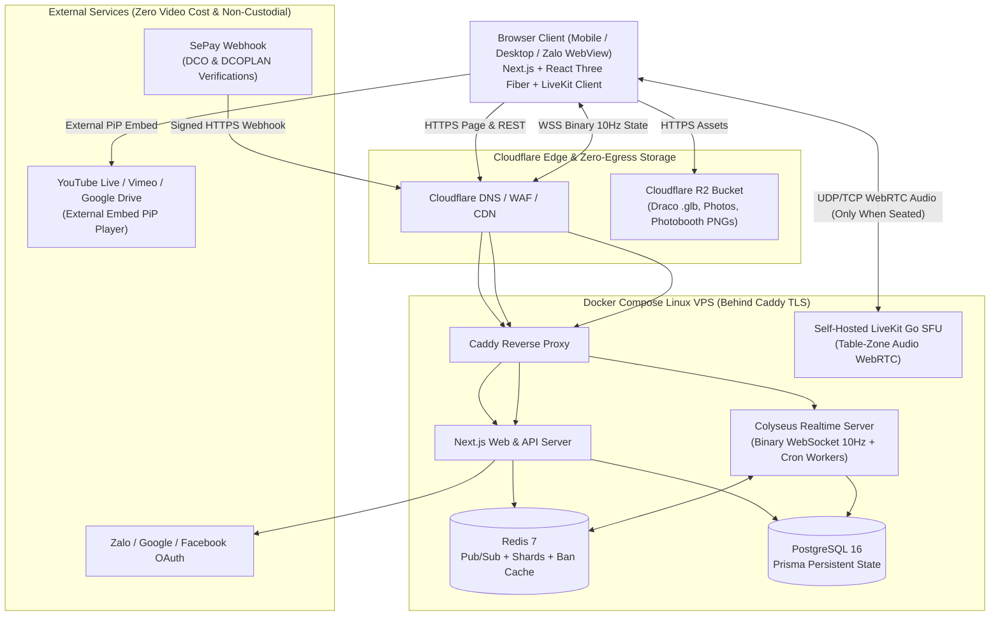

# 03 — System Architecture

## 1. Monorepo Directory Structure (`pnpm` + `Turborepo`)

The repository uses a single TypeScript monorepo so the **3D Grid-Snap Walkability Validator**, **Colyseus Schemas**, **Prefabs Catalog**, and **Prisma Types** are shared cleanly between frontend, realtime server, and background workers:

```text
DamCuoiOnline/
├── apps/
│   ├── web/                          # Next.js (App Router, TypeScript, Tailwind)
│   │   ├── src/app/
│   │   │   ├── (marketing)/          # Landing page & pricing
│   │   │   ├── plaza/                # 24/7 Public Wedding Plaza entry
│   │   │   ├── w/[slug]/             # Dynamic route: 3D Hall OR 2D Forever Memorial
│   │   │   ├── dashboard/            # Host Setup Wizard, 3D Builder, Private GiftLedger
│   │   │   └── api/
│   │   │       ├── auth/[...nextauth]/ # Zalo, Google, Facebook OAuth
│   │   │       ├── weddings/         # CRUD, join token, 3D layout validation, exports
│   │   │       ├── livekit/token/    # Table & Stage scoped JWT generator
│   │   │       ├── r2/presign/       # Direct browser -> Cloudflare R2 uploads
│   │   │       └── webhooks/
│   │   │           └── sepay/        # HMAC/API-Key verified SePay webhook
│   │   └── src/components/
│   │       ├── three/                # React Three Fiber scene, Chibi rigs, A* tap-to-move
│   │       ├── builder/              # 0.5m Grid-Snap 3D Scene Builder UI
│   │       ├── overlay/              # Draggable PiP Video Player, Photobooth, VietQR modal
│   │       └── memorial/             # Static/ISR 2D Forever Memorial Page components
│   │
│   └── realtime/                     # Dedicated Colyseus Node.js Server + Cron Workers
│       ├── src/
│       │   ├── rooms/
│       │   │   ├── WeddingHallRoom.ts # Authoritative 10Hz state, Auto-NPC, Bouquet Toss
│       │   │   └── PublicPlazaRoom.ts # Sharded 24/7 Plaza with 25-min ceremony loop
│       │   ├── services/
│       │   │   ├── redisPubSub.ts    # Cross-shard broadcasts (VietQR fireworks, Stage)
│       │   │   └── npcScheduler.ts   # Automated Bride/Groom NPC state machine
│       │   └── jobs/
│       │       ├── expireTrials.ts   # Runs every 15m: expires 24h Trial rooms
│       │       └── archiveWeddings.ts # Daily: weddingDate + 7d -> 2D Memorial Archive
│       └── src/index.ts
│
├── packages/
│   ├── shared/                       # Zero-dependency isomorphic TypeScript logic
│   │   ├── src/prefabs.ts            # Smart Prefab catalog & dimensions
│   │   ├── src/gridValidator.ts      # Occupancy grid builder & 2D BFS/A* validator
│   │   ├── src/profanity.ts          # Vietnamese + English profanity filter
│   │   ├── src/vietqr.ts             # EMVCo Napas QR payload & code generator
│   │   └── src/schemas.ts            # Shared Colyseus @colyseus/schema & Zod DTOs
│   │
│   └── database/                     # Prisma ORM Client & Migrations
│       ├── prisma/schema.prisma
│       └── src/index.ts
│
├── infra/
│   ├── docker-compose.yml            # Production VPS stack
│   ├── Caddyfile                     # Reverse proxy + automatic TLS
│   ├── livekit.yaml                  # Self-hosted LiveKit SFU config
│   └── .env.example
├── docs/                             # This specification suite
├── package.json
├── pnpm-workspace.yaml
└── turbo.json
```

---

## 2. High-Level System Architecture & Traffic Split

To handle viral spikes on a single or multi-core Linux VPS without paying heavy managed-cloud egress bills, data traffic is strictly segmented across specialized channels:



### Why This Traffic Split Scales Cost-Effectively
1. **Static & 3D Asset Offloading (`0 VND` Egress)**: All `.glb` models, KTX2 textures, pre-wedding albums, and Photobooth snapshots load directly from Cloudflare R2 via public CDN URLs. The VPS never serves heavy binary media.
2. **External Video Offloading (`0 VND` Video Bandwidth)**: Stage ceremonies embed YouTube Live / Vimeo / Google Drive directly in the client's synchronized PiP player—meaning `1,000` concurrent guests watching the live ceremony stream from YouTube's CDN, not your VPS.
3. **Lazy Table-Scoped WebRTC**: `LiveKit` (written in lightweight Go) handles audio-only opus streams (`~24 kbps` per active speaker) and **only connects when a guest sits at a table or when an MC broadcasts from Stage**. Walking guests consume `0` WebRTC resources.
4. **Compact Binary WebSockets**: Colyseus serializes `@colyseus/schema` diffs in binary format (`~40 bytes` per position delta at `10Hz`).

---

## 3. Multi-Hall Sharding & Cross-Shard Synchronization

A single 3D WebGL scene starts dropping frames on mid-range mobile devices once `> 60` animated Chibi avatars appear simultaneously. Rather than capping wedding attendance, **DamCuoiOnline** automatically shards large weddings into parallel identical sub-halls (`Hall 1`, `Hall 2`, `Hall 3`...).

### 3.1 Sharding Mechanics
- **Soft Cap (`50` CCU) & Hard Cap (`60` CCU)** per Colyseus `WeddingHallRoom` instance (in `24h Trial` mode, total room capacity is hard-capped at `15` CCU across `1` shard).
- **Friend-Following Hall Selector**:
  - When a guest calls `POST /api/weddings/[slug]/join`, the API checks active shards in Redis (`wedding:<id>:shards`).
  - Default assignment routes to the lowest-population shard under `50` players.
  - Guests can view a compact **"Chuyển Sảnh"** (`Switch Hall`) dropdown showing `Sảnh 1 (48/60)`, `Sảnh 2 (22/60)` plus where specific friends or family tables are gathered, allowing seamless 1-click hopping.

### 3.2 Cross-Shard Event Bus (`Redis Pub/Sub`)
Even when guests are spread across `Hall 1`, `Hall 2`, and `Hall 3`, the wedding must feel like **one unified celebration**:
- **Synchronized Ceremonies & Bouquet Toss**: Triggered on `Hall 1` (where the live Bride/Groom/MC are standing) or by `npcScheduler`, published via Redis channel `wedding:<id>:events` so all sibling shards execute `TRIGGER_CEREMONY`, `VIDEO_SYNC`, and `TOSS_BOUQUET` simultaneously.
- **Live Takeover Mirroring**: If the real Bride/Groom takes over their avatar in `Hall 1`, `Hall 2+` display a synchronized **Stage Mirror State** (or Keep Auto-NPCs mirroring the Host's ceremony actions) plus a badge indicating *"Cô dâu & Chú rể đang giao lưu trực tiếp tại Sảnh 1"*.
- **Global VietQR Celebration Fireworks**: When a SePay webhook confirms a gift transfer, Next.js API publishes `GIFT_CELEBRATION_EVENT` to Redis `wedding:<id>:events` so **every active shard** celebrates simultaneously with heart fireworks and the anonymized blessing toast.
- **Table Voice Scope**: To keep table chats intimate (`<= 10` people), Banquet Table IDs are shard-scoped (`wedding_<id>_shard_<shardIdx>_table_<tableNo>`), whereas Stage Broadcast (`STAGE_BROADCAST`) pipes MC audio into **all shards** for that wedding.
