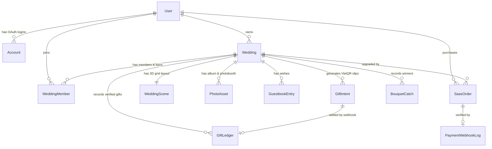

# 04 — Database Schema & Privacy Boundaries

## 1. Entity-Relationship Overview



---

## 2. Production Prisma Schema (`packages/database/prisma/schema.prisma`)

```prisma
generator client {
  provider = "prisma-client-js"
}

datasource db {
  provider = "postgresql"
  url      = env("DATABASE_URL")
}

// ==========================================
// 1. AUTHENTICATION & SOCIAL OAUTH
// ==========================================

enum AuthProvider {
  ZALO
  GOOGLE
  FACEBOOK
}

model User {
  id            String          @id @default(cuid())
  displayName   String
  avatarUrl     String?
  email         String?         @unique
  createdAt     DateTime        @default(now())
  updatedAt     DateTime        @updatedAt

  accounts      Account[]
  ownedWeddings Wedding[]       @relation("WeddingOwner")
  memberships   WeddingMember[]
  photoAssets   PhotoAsset[]
  guestbooks    GuestbookEntry[]
  giftIntents   GiftIntent[]
  giftLedgers   GiftLedger[]
  bouquetCatches BouquetCatch[]
  saasOrders    SaasOrder[]
}

model Account {
  id                String       @id @default(cuid())
  userId            String
  provider          AuthProvider
  providerAccountId String       // Social UID used for cross-session bans
  accessToken       String?      @db.Text
  refreshToken      String?      @db.Text
  expiresAt         Int?
  createdAt         DateTime     @default(now())

  user              User         @relation(fields: [userId], references: [id], onDelete: Cascade)

  @@unique([provider, providerAccountId])
  @@index([userId])
}

// ==========================================
// 2. WEDDINGS, TIERS & LIFECYCLE
// ==========================================

enum WeddingTier {
  PUBLIC_PLAZA
  TRIAL_24H
  HAPPINESS
  VIP_FULFILLMENT
}

enum WeddingStatus {
  DRAFT
  TRIAL_ACTIVE
  EXPIRED_TRIAL
  PUBLISHED_3D
  GRACE_PERIOD_7D
  ARCHIVED_2D_FOREVER
}

model Wedding {
  id                  String        @id @default(cuid())
  slug                String        @unique
  title               String        // e.g., "Lễ Thành Hôn Minh & Linh"
  brideName           String
  groomName           String
  ownerId             String
  tier                WeddingTier   @default(TRIAL_24H)
  status              WeddingStatus @default(DRAFT)

  weddingDate         DateTime      // Official ceremony timestamp (UTC)
  trialExpiresAt      DateTime?     // Set to now() + 24h for TRIAL_24H
  archiveAt           DateTime?     // Set to weddingDate + 7 days for paid rooms
  archivedAt          DateTime?     // Actual timestamp converted to 2D Memorial

  // Access Security
  pinHash             String?       // Optional 4-digit bcrypt/argon2 PIN hash
  maxConcurrentUsers  Int           @default(15) // 15 Trial, 100 Happiness, 1000+ VIP

  // External Stage Video / Livestream (Zero Video Bandwidth)
  videoEmbedUrl       String?       // YouTube Live, YouTube Video, Vimeo, Google Drive
  videoIsLive         Boolean       @default(false)

  // Non-Custodial VietQR & SePay Config (Strictly locked if tier == TRIAL_24H/PUBLIC_PLAZA)
  bankBin             String?       // e.g., "970436" (Vietcombank), "970422" (MBBank)
  bankAccountNo       String?
  bankAccountName     String?
  webhookProvider     String?       // "SEPAY"
  webhookSecretHash   String?       // Encrypted/hashed per-wedding webhook verifier

  // Auto-NPC Ceremony Schedule JSON: { ceremonyTimeIso, autoBouquetToss, greetingMessage }
  ceremonyConfig      Json?

  createdAt           DateTime      @default(now())
  updatedAt           DateTime      @updatedAt

  owner               User          @relation("WeddingOwner", fields: [ownerId], references: [id])
  scene               WeddingScene?
  members             WeddingMember[]
  photos              PhotoAsset[]
  guestbookEntries    GuestbookEntry[]
  giftIntents         GiftIntent[]
  giftLedgers         GiftLedger[]
  bouquetCatches      BouquetCatch[]
  saasOrders          SaasOrder[]

  @@index([status, archiveAt])
  @@index([status, trialExpiresAt])
  @@index([ownerId])
}

// ==========================================
// 3. MEMBERSHIP, ROLES & MODERATION
// ==========================================

enum MemberRole {
  OWNER
  BRIDE
  GROOM
  MC
  GUEST
}

enum ModerationStatus {
  ACTIVE
  MUTED
  BANNED
}

enum GuestSide {
  GROOM_SIDE
  BRIDE_SIDE
  FRIEND
  COLLEAGUE
}

model WeddingMember {
  id               String           @id @default(cuid())
  weddingId        String
  userId           String
  role             MemberRole       @default(GUEST)
  side             GuestSide        @default(FRIEND)
  nicknameOverride String?
  avatarConfig     Json?            // { outfitId, hairId, hairColor }
  moderationStatus ModerationStatus @default(ACTIVE)
  moderatedById    String?
  moderationReason String?
  joinedAt         DateTime         @default(now())
  updatedAt        DateTime         @updatedAt

  wedding          Wedding          @relation(fields: [weddingId], references: [id], onDelete: Cascade)
  user             User             @relation(fields: [userId], references: [id], onDelete: Cascade)

  @@unique([weddingId, userId])
  @@index([weddingId, moderationStatus])
}

// ==========================================
// 4. 3D GRID-SNAP SCENE & R2 MEDIA
// ==========================================

model WeddingScene {
  id          String   @id @default(cuid())
  weddingId   String   @unique
  templateId  String   @default("luxury_ballroom")
  layoutData  Json     // Strictly matches SceneLayoutDocument JSON Schema
  version     Int      @default(1)
  updatedAt   DateTime @updatedAt

  wedding     Wedding  @relation(fields: [weddingId], references: [id], onDelete: Cascade)
}

enum PhotoType {
  PRE_WEDDING_GALLERY
  PHOTOBOOTH_SNAPSHOT
}

model PhotoAsset {
  id           String    @id @default(cuid())
  weddingId    String
  uploaderId   String
  type         PhotoType
  r2ObjectKey  String    // e.g., "weddings/<id>/gallery/<uuid>.webp"
  publicUrl    String
  caption      String?   @db.VarChar(200)
  hasWatermark Boolean   @default(false) // true for TRIAL_24H Photobooth shots
  displayOrder Int       @default(0)
  createdAt    DateTime  @default(now())

  wedding      Wedding   @relation(fields: [weddingId], references: [id], onDelete: Cascade)
  uploader     User      @relation(fields: [uploaderId], references: [id])

  @@index([weddingId, type])
}

// ==========================================
// 5. SOCIAL MEMORIES & MINI-GAMES
// ==========================================

model GuestbookEntry {
  id          String   @id @default(cuid())
  weddingId   String
  authorId    String
  authorName  String
  side        GuestSide @default(FRIEND)
  message     String   @db.VarChar(500)
  isHidden    Boolean  @default(false)
  createdAt   DateTime @default(now())

  wedding     Wedding  @relation(fields: [weddingId], references: [id], onDelete: Cascade)
  author      User     @relation(fields: [authorId], references: [id])

  @@index([weddingId, createdAt])
}

model BouquetCatch {
  id          String   @id @default(cuid())
  weddingId   String
  winnerId    String
  winnerName  String
  shardId     String
  caughtAt    DateTime @default(now())

  wedding     Wedding  @relation(fields: [weddingId], references: [id], onDelete: Cascade)
  winner      User     @relation(fields: [winnerId], references: [id])

  @@index([weddingId, caughtAt])
}

// ==========================================
// 6. VIETQR GIFTING (NON-CUSTODIAL & PRIVATE)
// ==========================================

enum GiftIntentStatus {
  PENDING
  VERIFIED
  EXPIRED
}

model GiftIntent {
  id           String           @id @default(cuid())
  weddingId    String
  guestUserId  String
  guestName    String
  wishMessage  String           @db.VarChar(300)
  transferCode String           @unique // Format: DCO + 6 alphanumeric chars (e.g. DCO9K2M4)
  status       GiftIntentStatus @default(PENDING)
  expiresAt    DateTime
  createdAt    DateTime         @default(now())

  wedding      Wedding          @relation(fields: [weddingId], references: [id], onDelete: Cascade)
  guest        User             @relation(fields: [guestUserId], references: [id])
  ledger       GiftLedger?

  @@index([weddingId, status])
}

// STRICT PRIVACY: Never serialize amountVnd or bankRefId to public/guest endpoints!
model GiftLedger {
  id              String   @id @default(cuid())
  weddingId       String
  giftIntentId    String   @unique
  guestUserId     String
  guestName       String
  wishMessage     String   @db.VarChar(300)
  amountVnd       Int      // Private to OWNER, BRIDE, GROOM only
  provider        String   // "SEPAY"
  providerTxId    String   @unique // Idempotency key preventing duplicate webhooks
  bankTxDate      DateTime
  verifiedAt      DateTime @default(now())

  wedding         Wedding    @relation(fields: [weddingId], references: [id], onDelete: Cascade)
  giftIntent      GiftIntent @relation(fields: [giftIntentId], references: [id])
  guest           User       @relation(fields: [guestUserId], references: [id])

  @@index([weddingId, verifiedAt])
}

// ==========================================
// 7. SAAS PLATFORM BILLING & WEBHOOK AUDIT
// ==========================================

enum OrderStatus {
  PENDING
  PAID
  CANCELLED
}

model SaasOrder {
  id           String      @id @default(cuid())
  weddingId    String
  buyerId      String
  targetTier   WeddingTier
  amountVnd    Int
  orderCode    String      @unique // Format: DCOPLAN + 6 chars (e.g. DCOPLAN7X4P9A)
  status       OrderStatus @default(PENDING)
  paidAt       DateTime?
  createdAt    DateTime    @default(now())

  wedding      Wedding     @relation(fields: [weddingId], references: [id])
  buyer        User        @relation(fields: [buyerId], references: [id])
  webhookLog   PaymentWebhookLog?

  @@index([status, orderCode])
}

model PaymentWebhookLog {
  id             String     @id @default(cuid())
  provider       String     // "SEPAY"
  providerTxId   String     @unique // Guarantees exactly-once processing
  saasOrderId    String?    @unique
  rawPayload     Json
  processedAt    DateTime   @default(now())

  saasOrder      SaasOrder? @relation(fields: [saasOrderId], references: [id])
}
```

---

## 3. Data Privacy & Archival Query Patterns

### 3.1 Strict `GiftLedger` Isolation
- **Public / Guest Room Endpoints & WebSocket Broadcasts**: Only emit `{ guestName, wishMessage, verifiedAt }` sourced from `GiftIntent` / Redis celebration payload. The column `GiftLedger.amountVnd` is **forbidden** from leaving host-authenticated serializers.
- **Host Ledger Endpoint (`GET /api/weddings/[slug]/ledger`)**: Checks `WeddingMember.role IN ('OWNER', 'BRIDE', 'GROOM')`. Notice that even `MC` moderators are **excluded** from seeing private monetary amounts.

### 3.2 Indexing & Archival Queries
- **Daily 2D Archive Job** (`archiveWeddings.ts`): Queries `WHERE status IN ('PUBLISHED_3D', 'GRACE_PERIOD_7D') AND archiveAt <= NOW()`. Updates `status = 'ARCHIVED_2D_FOREVER'`, `archivedAt = NOW()`, and publishes `FORCE_ARCHIVE_ROOM` over Redis to disconnect active Colyseus rooms cleanly.
- **15-Minute Trial Expiry Job** (`expireTrials.ts`): Queries `WHERE tier = 'TRIAL_24H' AND status = 'TRIAL_ACTIVE' AND trialExpiresAt <= NOW()`. Sets `status = 'EXPIRED_TRIAL'`.
- **Static/ISR 2D Memorial Page Query**: Fetches `Wedding`, `PhotoAsset` (both `PRE_WEDDING_GALLERY` and `PHOTOBOOTH_SNAPSHOT`), `GuestbookEntry (WHERE isHidden = false)`, and `BouquetCatch` in a single read-only Prisma query cached by Next.js ISR and invalidated only when a new photo or hidden flag changes.
