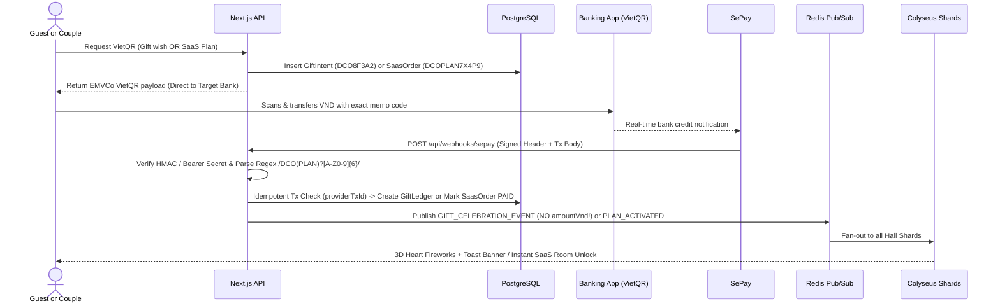

# 05 — Realtime & Webhook Protocols

## 1. Colyseus Authoritative State Schemas (`@colyseus/schema`)

The `WeddingHallRoom` runs a `10Hz` (`100ms`) simulation tick loop while clients interpolate positions smoothly at `60Hz` using linear interpolation (`lerp`) and skeletal velocity blending.

```typescript
import { Schema, MapSchema, type } from '@colyseus/schema';

export class PlayerSchema extends Schema {
  @type('string') sessionId!: string;
  @type('string') userId!: string;        // Social OAuth userId (or guestId in Plaza)
  @type('string') displayName!: string;
  @type('string') role!: string;          // OWNER | BRIDE | GROOM | MC | GUEST
  @type('string') side!: string;          // GROOM_SIDE | BRIDE_SIDE | FRIEND | COLLEAGUE
  @type('string') outfitId!: string;
  @type('string') hairId!: string;
  @type('string') hairColor!: string;

  // Spatial Transform (Server authoritative)
  @type('number') x: number = 0;
  @type('number') z: number = 0;
  @type('number') rotY: number = 0;
  @type('string') anim: string = 'idle';  // idle | walk | sit | clap | cheers | jump_catch | wave | bow

  // Seating & Social State
  @type('number') seatedTableNo: number = -1; // -1 = standing/walking
  @type('number') seatIndex: number = -1;
  @type('boolean') hasBouquetCrown: boolean = false;
  @type('boolean') isSpeaking: boolean = false;
  @type('boolean') isMuted: boolean = false;
  @type('string') takingOverNpc: string = ''; // '' | 'BRIDE' | 'GROOM'

  // Ephemeral Chat Bubble
  @type('string') bubbleText: string = '';
  @type('number') bubbleExpiresAt: number = 0;
}

export class NpcSchema extends Schema {
  @type('string') npcId!: string;         // 'BRIDE' | 'GROOM'
  @type('string') displayName!: string;
  @type('string') outfitId!: string;
  @type('boolean') isTakenOver: boolean = false; // Hidden when real Bride/Groom takes over
  @type('string') mode: string = 'GREETING';     // GREETING | STAGE_CEREMONY | IDLE
  @type('number') x: number = 0;
  @type('number') z: number = 0;
  @type('number') rotY: number = 0;
  @type('string') anim: string = 'wave';
}

export class CeremonySchema extends Schema {
  @type('string') activeRitual: string = 'NONE'; // NONE | CAKE_CUT | CHAMPAGNE | SPARKLERS
  @type('number') ritualEndsAt: number = 0;
  @type('boolean') stageBroadcastActive: boolean = false;
  @type('string') broadcastHostName: string = '';
}

export class BouquetSchema extends Schema {
  @type('string') status: string = 'IDLE'; // IDLE | COUNTDOWN | IN_FLIGHT | CAUGHT
  @type('number') originX: number = 0;
  @type('number') originZ: number = 0;
  @type('number') targetX: number = 0;
  @type('number') targetZ: number = 0;
  @type('number') tossStartTs: number = 0;
  @type('number') flightDurationMs: number = 2400;
  @type('string') winnerSessionId: string = '';
  @type('string') winnerName: string = '';
}

export class VideoSyncSchema extends Schema {
  @type('string') embedUrl: string = '';
  @type('boolean') isLive: boolean = false;
  @type('boolean') isPlaying: boolean = false;
  @type('number') playbackOffsetSec: number = 0;
  @type('number') updatedAtServerTs: number = 0;
}

export class WeddingRoomState extends Schema {
  @type('string') weddingId!: string;
  @type('string') tier!: string;
  @type('number') shardIndex: number = 1;
  @type({ map: PlayerSchema }) players = new MapSchema<PlayerSchema>();
  @type({ map: NpcSchema }) npcs = new MapSchema<NpcSchema>();
  @type(CeremonySchema) ceremony = new CeremonySchema();
  @type(BouquetSchema) bouquet = new BouquetSchema();
  @type(VideoSyncSchema) videoSync = new VideoSyncSchema();
}
```

---

## 2. WebSocket Message Catalog (`Client <-> Colyseus`)

| Message Type | Direction | Payload | Validation & Server Authority |
| :--- | :--- | :--- | :--- |
| `MOVE_INPUT` | `C -> S` | `{ x, z, rotY, isMoving }` | Clamped to `60x60` walkable grid bounds; speed capped (`<= 5.5 m/s`); rate-limited at `15 msg/sec`. |
| `SIT_TABLE` | `C -> S` | `{ tableNo, seatIndex }` | Verifies seat is unoccupied; snaps player transform to `SeatAnchor`, sets `anim = 'sit'`. |
| `STAND_UP` | `C -> S` | `{}` | Frees seat (`seatedTableNo = -1`), client disconnects LiveKit table room. |
| `CHAT_BUBBLE` | `C -> S` | `{ text }` | Rejects if `isMuted`; trims to `80` chars; runs profanity filter; sets `bubbleExpiresAt = now + 5000ms` & logs to room chat feed (`<= 1 msg / 1.5s`). |
| `EMOTE` | `C -> S` | `{ anim }` | Whitelisted clips (`wave`, `clap`, `bow`); clears after clip duration. |
| `TABLE_CHEERS` | `C -> S` | `{}` | Requires `seatedTableNo >= 0`; broadcasts `TABLE_CHEERS_BURST` (`tableNo`, `countdownSec: 3`) to all room clients so seated avatars play `cheers` in unison. |
| `NPC_TAKEOVER` | `C -> S` | `{ targetNpc: 'BRIDE' \| 'GROOM' }` | Requires `role IN ('OWNER', 'BRIDE', 'GROOM', 'MC')`; swaps player outfit to bridal/groom rig, marks `npc.isTakenOver = true`. |
| `NPC_RELEASE` | `C -> S` | `{}` | Restores guest outfit and resumes Auto-NPC routine. |
| `TRIGGER_CEREMONY` | `C -> S` | `{ ritual, stageBroadcast }` | Requires `OWNER/BRIDE/GROOM/MC`; relays across all shards via Redis Pub/Sub. |
| `TOSS_BOUQUET` | `C -> S` | `{}` | Requires `OWNER/BRIDE/GROOM/MC` (or Auto-NPC scheduler); picks random walkable landing spot `4-8m` in front of stage; starts 5s countdown then `IN_FLIGHT`. |
| `ATTEMPT_CATCH` | `C -> S` | `{}` | Sets `anim = 'jump_catch'`; server awards catch to first player within `1.8m` of `(targetX, targetZ)` during `elapsed >= 0.85 * flightDurationMs`. |
| `VIDEO_CONTROL` | `C -> S` | `{ isPlaying, playbackOffsetSec }` | Requires `OWNER/BRIDE/GROOM/MC`; updates `VideoSyncSchema` and broadcasts across shards for synchronized PiP viewing. |
| `MOD_ACTION` | `C -> S` | `{ targetUserId, action: 'MUTE' \| 'KICK' \| 'BAN' }` | Requires `OWNER/BRIDE/GROOM/MC`; updates `WeddingMember.moderationStatus`, writes Social UID to Redis ban set, disconnects socket immediately if `KICK`/`BAN`. |
| `GIFT_CELEBRATION_EVENT` | `S -> C` | `{ guestName, wishMessage }` | Triggered **exclusively** by Redis Pub/Sub after verified SePay webhook; **never includes `amountVnd`**. |

---

## 3. LiveKit Table-Zone Voice & Audio Ducking Protocol

Available exclusively on **`VIP_FULFILLMENT`** rooms (`PUBLIC_PLAZA`, `TRIAL_24H`, and `HAPPINESS` return `403` from `/api/livekit/token`).

### 3.1 Token Scoping Rules
- **Table Conversation Token**:
  - Issued only when Colyseus confirms the requesting user is currently seated at `tableNo`.
  - LiveKit Room Name: `wedding_<weddingId>_shard_<shardIndex>_table_<tableNo>`.
  - Grants: `{ canPublish: !member.isMuted, canSubscribe: true, canPublishData: false }`.
- **Stage Broadcast Token**:
  - Issued only to `OWNER`, `BRIDE`, `GROOM`, or `MC` activating `STAGE_BROADCAST`.
  - LiveKit Room Name: `wedding_<weddingId>_stage`.
  - Guests subscribe to `wedding_<weddingId>_stage` in **receive-only mode** (`canPublish: false`) only while `ceremony.stageBroadcastActive == true`.

### 3.2 Client Audio Ducking (`-12dB`)
When `WeddingRoomState.ceremony.stageBroadcastActive` flips to `true`:
1. Client subscribes automatically to `wedding_<weddingId>_stage` audio track at `1.0` (`0dB`) gain.
2. Client reduces gain on all active `wedding_*_table_*` remote audio participants to `0.25` (`-12dB`) and reduces ambient BGM to `0.1` (`-20dB`).
3. When `stageBroadcastActive` returns to `false`, gains ramp smoothly back to `1.0` over `500ms`.

---

## 4. External Video & Livestream PiP Sync Protocol

To maintain **zero video hosting/transcoding costs**, the platform strictly accepts external embed links (`YouTube Live`, `YouTube Video`, `Vimeo`, `Google Drive`).
1. **URL Sanitizer**: Backend parses and validates allowlisted hostnames only (`youtube.com`, `youtu.be`, `vimeo.com`, `drive.google.com`) and extracts canonical `embedSrc` + provider ID.
2. **Stage 3D LED Mesh**: Displays a crisp static/thumbnail texture + animated glowing `"LIVE / CLICK TO WATCH"` shader without rendering heavy video frames into WebGL memory.
3. **Synchronized PiP Overlay**: Clicking the Stage LED (or automatically when MC enables `VIDEO_CONTROL`) opens a **Draggable Picture-in-Picture / Theater Overlay** rendering the sanitized `<iframe>`.
   - If `isLive == true`, all guests load the live stream edge directly.
   - If `isLive == false` (Pre-wedding/Ceremony VOD), clients compute `targetTime = playbackOffsetSec + (serverNow - updatedAtServerTs)/1000` and seek via the YouTube/Vimeo Player PostMessage API if drift exceeds `> 3 seconds`.

---

## 5. Automated SePay VietQR Webhook Protocol

Both **Wedding Gift Boxes (`DCO<code>`)** and **SaaS Plan Upgrades (`DCOPLAN<code>`)** share one hardened webhook pipeline guaranteeing zero false positives:



### Verification & Security Details
1. **Regex Code Extraction**: Extracts `DCOPLAN[A-Z0-9]{6}` first (platform billing) or `DCO[A-Z0-9]{6}` (wedding gift) from the normalized transfer description (case-insensitive, stripping accidental spaces/hyphens).
2. **Signature & Secret Validation**:
   - **Platform Billing (`DCOPLAN*`)**: Verified against the platform SePay API key (set in `/admin/settings`).
   - **Couple Gift Box (`DCO*`)**: Endpoint `/api/webhooks/sepay/[weddingId]` verifies against the couple's `Wedding.webhookSecretHash` AND confirms `Wedding.tier` is `HAPPINESS` or `VIP_FULFILLMENT`.
3. **Amount Validation**:
   - For `SaasOrder`, received `transferAmount >= order.amountVnd` is strictly required before upgrading `Wedding.tier` and setting `status = PUBLISHED_3D`.
   - For `GiftIntent`, any positive `amountVnd >= 1000` is accepted into `GiftLedger`; `GiftIntent.status` flips to `VERIFIED`.
4. **Idempotency**: `providerTxId` has a `UNIQUE` database constraint in `GiftLedger` and `PaymentWebhookLog`. Duplicate webhook retries return `200 OK` immediately without firing duplicate 3D fireworks.
